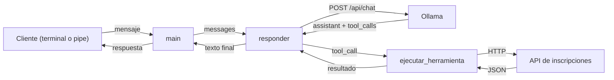
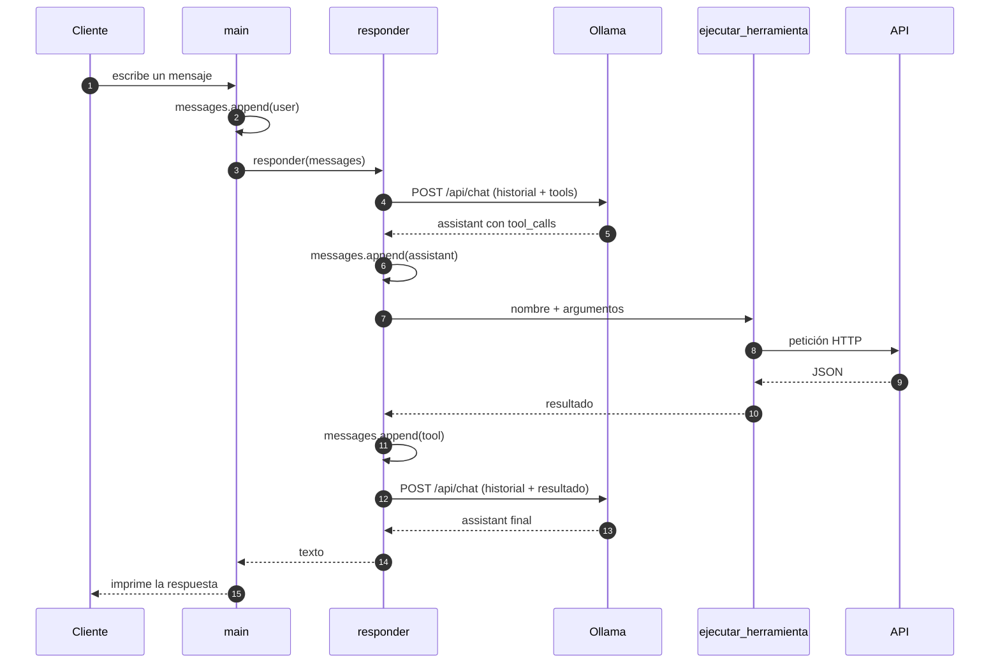
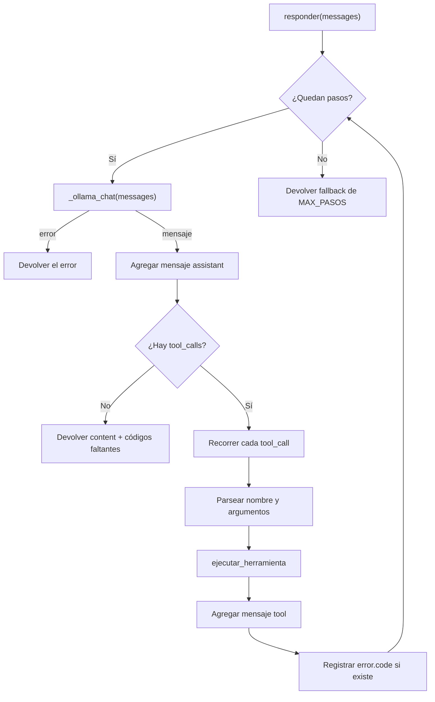

# Agente de inscripciones

`agent.py` implementa un agente conversacional de línea de comandos. El programa mantiene el historial de la conversación en memoria, se lo envía a un modelo servido por Ollama y ejecuta las herramientas que el modelo solicita contra la API HTTP de inscripciones. `test_agent.py` contiene pruebas que describen el comportamiento esperado de esas herramientas y del bucle de conversación.

El agente no tiene interfaz gráfica ni base de datos propia: toda la información de alumnos, materias e inscripciones vive en la API. El modelo no accede a la API directamente; solo produce pedidos de herramientas con nombre y argumentos, y el código Python es quien los ejecuta.

## 1. Vista general



| Componente | Responsabilidad |
|---|---|
| `main` | Lee la entrada, mantiene el historial y muestra la respuesta |
| `responder` | Coordina las llamadas al modelo y la ejecución de herramientas |
| `_ollama_chat` | Habla con Ollama por HTTP |
| `ejecutar_herramienta` | Traduce un `tool_call` a una operación concreta |
| `_api` | Centraliza las llamadas HTTP a la API de inscripciones |
| `_system_prompt` | Arma el mensaje de sistema con el legajo actual |
| `_verificar_servicios` | Comprueba que la API y Ollama estén disponibles |

## 2. Mapa del código

Las líneas corresponden a la versión actual de `agent.py` (293 líneas).

| Sección | Líneas | Rol |
|---|---|---|
| Configuración | [`agent.py:9-14`](agent.py#L9-L14) | Constantes de conexión y comportamiento |
| `SYSTEM_PROMPT` | [`agent.py:16-30`](agent.py#L16-L30) | Reglas que recibe el modelo |
| `TOOLS` | [`agent.py:32-52`](agent.py#L32-L52) | Esquemas de las herramientas |
| `_normalizar` | [`agent.py:55-60`](agent.py#L55-L60) | Normalización de texto |
| `_debug_habilitado` | [`agent.py:63-64`](agent.py#L63-L64) | Lectura de la variable `DEBUG` |
| `_debug` | [`agent.py:67-69`](agent.py#L67-L69) | Trazas por `stderr` |
| `_debug_api` | [`agent.py:72-77`](agent.py#L72-L77) | Trazas específicas de HTTP |
| `_api` | [`agent.py:80-98`](agent.py#L80-L98) | Cliente HTTP de la API |
| `ejecutar_herramienta` | [`agent.py:101-117`](agent.py#L101-L117) | Dispatch de herramientas |
| `_ollama_chat` | [`agent.py:120-150`](agent.py#L120-L150) | Cliente HTTP de Ollama |
| `responder` | [`agent.py:153-211`](agent.py#L153-L211) | Bucle del agente |
| `_system_prompt` | [`agent.py:214-222`](agent.py#L214-L222) | Inyección de `LEGAJO_ACTUAL` |
| `_verificar_servicios` | [`agent.py:225-259`](agent.py#L225-L259) | Health checks de API y Ollama |
| `main` | [`agent.py:262-293`](agent.py#L262-L293) | REPL, entrada por pipe y salida |

## 3. Flujo de un turno



1. `main` lee una línea y la agrega a `messages` con `role: "user"`.
2. `main` llama a `responder(messages)`.
3. `responder` llama a `_ollama_chat(messages)`.
4. Ollama devuelve un mensaje `assistant`. Puede tener `content`, `tool_calls`, o ambos.
5. `responder` agrega ese mensaje al historial.
6. Si hay `tool_calls`, ejecuta cada una con `ejecutar_herramienta`.
7. Cada resultado se agrega al historial como un mensaje `role: "tool"`.
8. El historial actualizado se vuelve a enviar a Ollama.
9. Cuando Ollama devuelve un mensaje sin `tool_calls`, ese `content` es la respuesta final.

### Roles de los mensajes

| `role` | `content` | Campos extra | Quién lo agrega |
|---|---|---|---|
| `system` | Reglas del asistente | — | `main`, al iniciar |
| `user` | Texto del usuario | — | `main`, en cada turno |
| `assistant` | Texto parcial o vacío | `tool_calls` si pidió herramientas | `responder` |
| `tool` | Resultado serializado en JSON | `tool_name` | `responder` |
| `assistant` | Respuesta final | — | `responder` |

## 4. Configuración y constantes

[`agent.py:9-14`](agent.py#L9-L14)

| Constante | Valor por defecto | Efecto |
|---|---|---|
| `API_URL` | `http://localhost:8008` | Base de la API de inscripciones |
| `OLLAMA_URL` | `http://localhost:11434` | Base de Ollama |
| `MODEL` | `qwen3.5:9b` | Modelo que hace el tool calling |
| `LEGAJO_ACTUAL` | `None` | Legajo que el prompt usa por defecto |
| `MAX_PASOS` | `8` | Cantidad máxima de llamadas al modelo por turno |

`LEGAJO_ACTUAL` no reemplaza al legajo que el modelo recibe en la conversación: solo agrega una nota al mensaje de sistema. Con `None`, el agente no tiene un alumno fijo y el prompt indica que pida el legajo cuando haga falta.

`MAX_PASOS` cuenta llamadas al modelo, no herramientas. Una sola vuelta puede ejecutar varias `tool_calls` y todas cuentan como una única llamada al modelo.

## 5. System prompt

[`agent.py:16-30`](agent.py#L16-L30) y [`agent.py:214-222`](agent.py#L214-L222)

El mensaje de sistema define el rol y las restricciones del asistente:

- responde en español, breve y claro;
- usa las herramientas para consultar datos reales y no inventa códigos, legajos, cupos, IDs ni nombres;
- para inscribir necesita legajo, materia y turno;
- la API valida cupo, correlativas, choque de turno, duplicados y materias aprobadas;
- si la API rechaza una inscripción, la respuesta final incluye el código exacto del error;
- para dar de baja, primero lista las inscripciones y usa el `id` exacto;
- no crea, edita ni borra alumnos o materias, ni resetea la base;
- si falta el legajo, la materia o el turno, pregunta.

Los códigos de error que menciona el prompt son:

```text
MATERIA_APROBADA
SIN_CUPO
CORRELATIVA_PENDIENTE
CHOQUE_TURNO
INSCRIPCION_DUPLICADA
TURNO_NO_DISPONIBLE
```

El texto `{legajo}` del prompt se completa en `_system_prompt()`. Los dos casos posibles son:

```text
# LEGAJO_ACTUAL = "1001"
El alumno actual es 1001; usalo por defecto cuando no se indique otro.
```

```text
# LEGAJO_ACTUAL = None
No hay un alumno fijado; pedí el legajo cuando haga falta.
```

El prompt se envía como primer elemento de `messages` y viaja en cada llamada a Ollama. Por eso el modelo conserva las reglas durante todo el turno.

## 6. Herramientas

[`agent.py:32-52`](agent.py#L32-L52)

`TOOLS` es una lista de esquemas compatible con el tool calling de Ollama. Cada elemento describe una función que el modelo puede pedir. El esquema de `obtener_alumno` es el único declarado en la versión actual:

```python
{
    "type": "function",
    "function": {
        "name": "obtener_alumno",
        "description": "Devuelve un alumno con sus materias aprobadas.",
        "parameters": {
            "type": "object",
            "properties": {
                "legajo": {
                    "type": "string",
                    "description": "Legajo del alumno, por ejemplo 1001.",
                }
            },
            "required": ["legajo"],
        },
    },
}
```

La `description` y el esquema de `parameters` son la información que el modelo usa para decidir cuándo llamar a la herramienta y cómo armar los argumentos. El esquema no ejecuta nada: es documentación para el modelo.

Cuando el modelo decide usar una herramienta, devuelve un `tool_call` con esta forma:

```json
{
    "function": {
        "name": "obtener_alumno",
        "arguments": {"legajo": "1001"}
    }
}
```

`arguments` puede llegar como objeto JSON o como string JSON. `responder` contempla los dos casos.

### Cobertura actual

| Herramienta | Declarada en `TOOLS` | Manejada en `ejecutar_herramienta` |
|---|---|---|
| `obtener_alumno` | Sí | Sí |
| `buscar_materias` | No | No |
| `obtener_materia` | No | No |
| `listar_inscripciones` | No | No |
| `inscribir` | No | No |
| `dar_de_baja` | No | No |

Cualquier nombre que no coincida con una rama implementada termina en `{"error": "Herramienta desconocida: <nombre>"}`.

### Comportamiento descrito por `test_agent.py`

| Herramienta | Argumentos | Endpoint | Resultado esperado |
|---|---|---|---|
| `buscar_materias` | `texto` (opcional) | `GET /materias` | Lista de `{"codigo", "nombre"}`. Sin texto devuelve todas; con texto filtra por código o nombre sin distinguir mayúsculas ni acentos |
| `obtener_materia` | `codigo` | `GET /materias/{codigo}` | Materia completa, con correlativas y turnos |
| `obtener_alumno` | `legajo` | `GET /alumnos/{legajo}` | Alumno con sus materias aprobadas |
| `listar_inscripciones` | `alumno` (opcional) | `GET /inscripciones` | Inscripciones filtradas por alumno; si no viene, usa `LEGAJO_ACTUAL` |
| `inscribir` | `alumno`, `materia`, `turno` | `POST /inscripciones` | Inscripción creada o error de la API |
| `dar_de_baja` | `inscripcion_id` | `DELETE /inscripciones/{id}` | `{"ok": True}` cuando la API responde 204 |

La tabla describe lo que las pruebas fijan para cada herramienta. La única rama que existe hoy en `ejecutar_herramienta` es la de `obtener_alumno`.

## 7. Capa HTTP: `_api`

[`agent.py:80-98`](agent.py#L80-L98)

`_api(method, path, payload=None)` es el único punto por el que el agente habla con la API. Recibe el método, la ruta relativa y, opcionalmente, un cuerpo JSON. La llamada usa `requests.request(..., timeout=10)`.

### Comportamiento

| Situación | Resultado |
|---|---|
| Conexión fallida | `{"error": "No se pudo conectar a la API: <detalle>"}` |
| Status 204 | `{"ok": True}` |
| Status 2xx con JSON | El JSON parseado |
| Status 2xx sin JSON | El texto de la respuesta |
| Status 4xx o 5xx | `{"error": <cuerpo de la API>}` |

El error se devuelve como dato, no como excepción. De esa forma el resultado llega al modelo como cualquier otro resultado de herramienta y el modelo puede explicar el rechazo.

### Ejemplos

Consulta exitosa:

```http
GET /alumnos/1001
```

```json
{
    "legajo": "1001",
    "nombre": "Ana",
    "apellido": "Pérez",
    "aprobadas": ["CNE", "SI101"]
}
```

Baja exitosa:

```http
DELETE /inscripciones/3
```

```text
204 No Content
```

El valor que recibe el agente es:

```json
{"ok": true}
```

Error de la API:

```http
POST /inscripciones
Content-Type: application/json

{"alumno": "1001", "materia": "CNE", "turno": "manana"}
```

```http
409 Conflict
```

```json
{
    "code": "SIN_CUPO",
    "detail": "No hay cupo en CNE turno manana"
}
```

El valor que recibe el agente es:

```json
{
    "error": {
        "code": "SIN_CUPO",
        "detail": "No hay cupo en CNE turno manana"
    }
}
```

### Trazas de depuración

[`agent.py:63-77`](agent.py#L63-L77)

`_debug_habilitado()` considera habilitado el debug si `DEBUG` vale `1`, `true`, `yes` u `on`, sin distinguir mayúsculas. `_debug()` escribe en `stderr` con el prefijo `[debug]`. `_debug_api()` agrega el método, la ruta, el payload cuando existe y el status o el error de conexión.

Ejemplo de salida con `DEBUG=1`:

```text
[debug] API GET /alumnos/1001 -> 200
[debug] API POST /inscripciones {"alumno": "1001", "materia": "CNE", "turno": "manana"} -> 409
```

Los parámetros que van en el path se codifican con `quote(..., safe="")`. `obtener_alumno` lo usa con el legajo para evitar caracteres problemáticos en la URL.

## 8. Dispatch: `ejecutar_herramienta`

[`agent.py:101-117`](agent.py#L101-L117)

La función recibe el nombre de la herramienta y los argumentos que produjo el modelo. Su flujo es:

1. Verifica que `argumentos` sea un diccionario.
2. Entra en un bloque `try`.
3. Compara `nombre` contra las ramas implementadas.
4. Lee los argumentos con `argumentos.get(...)`.
5. Valida los obligatorios y devuelve un error claro si falta alguno.
6. Llama a `_api` con el método, la ruta y el payload correspondientes.
7. Si aparece `KeyError`, `TypeError` o `ValueError`, devuelve `{"error": "Argumentos inválidos: ..."}`.
8. Si ninguna rama coincide, devuelve `{"error": "Herramienta desconocida: <nombre>"}`.

La rama implementada es:

```python
if nombre == "obtener_alumno":
    legajo = argumentos.get("legajo")
    if not legajo:
        return {"error": "Falta el legajo"}
    return _api("GET", f"/alumnos/{quote(str(legajo), safe='')}")
```

### Ejemplos de llamadas

| Llamada | Resultado |
|---|---|
| `ejecutar_herramienta("obtener_alumno", {"legajo": "1001"})` | JSON del alumno o `{"error": ...}` |
| `ejecutar_herramienta("obtener_alumno", {})` | `{"error": "Falta el legajo"}` |
| `ejecutar_herramienta("obtener_alumno", "1001")` | `{"error": "Argumentos inválidos"}` |
| `ejecutar_herramienta("no_existe", {})` | `{"error": "Herramienta desconocida: no_existe"}` |

El resultado se serializa con `json.dumps(..., ensure_ascii=False)` y se agrega a `messages` como `role: "tool"` con el nombre de la herramienta en `tool_name`.

## 9. Cliente de Ollama

[`agent.py:120-150`](agent.py#L120-L150)

`_ollama_chat(messages)` arma el payload y lo envía a `POST /api/chat` con `requests.post(..., timeout=120)`.

```json
{
    "model": "qwen3.5:9b",
    "messages": [
        {"role": "system", "content": "..."},
        {"role": "user", "content": "¿Qué datos tiene el legajo 1001?"}
    ],
    "tools": [
        {
            "type": "function",
            "function": {
                "name": "obtener_alumno",
                "description": "Devuelve un alumno con sus materias aprobadas.",
                "parameters": {
                    "type": "object",
                    "properties": {
                        "legajo": {"type": "string"}
                    },
                    "required": ["legajo"]
                }
            }
        }
    ],
    "stream": false,
    "think": false,
    "options": {"temperature": 0}
}
```

| Campo | Valor | Efecto |
|---|---|---|
| `model` | `MODEL` | Modelo que responde |
| `messages` | Historial completo | Contexto de la conversación |
| `tools` | `TOOLS` | Herramientas disponibles |
| `stream` | `false` | Una respuesta completa por pedido |
| `think` | `false` | Desactiva el modo de razonamiento de algunos modelos |
| `options.temperature` | `0` | Respuestas más deterministas |

La respuesta relevante de Ollama tiene esta forma simplificada:

```json
{
    "message": {
        "role": "assistant",
        "content": "",
        "tool_calls": [
            {
                "function": {
                    "name": "obtener_alumno",
                    "arguments": {"legajo": "1001"}
                }
            }
        ]
    }
}
```

Cuando el modelo ya tiene la respuesta final, `content` trae el texto y `tool_calls` no aparece o viene vacío:

```json
{
    "message": {
        "role": "assistant",
        "content": "El alumno 1001 es Ana Pérez y tiene aprobadas CNE y SI101."
    }
}
```

### Manejo de errores

| Condición | Retorno de `_ollama_chat` |
|---|---|
| No se puede conectar | `(None, "No se pudo conectar a Ollama: ...")` |
| Status distinto de 200 | `(None, "Ollama respondió <status>: <texto>")` |
| La respuesta no es JSON | `(None, "Ollama devolvió una respuesta que no es JSON")` |
| La respuesta tiene campo `error` | `(None, "Ollama: <error>")` |
| La respuesta no tiene `message` | `(None, "Ollama devolvió una respuesta sin mensaje")` |
| Respuesta válida | `(message, None)` |

Con `DEBUG` habilitado, `_ollama_chat` imprime la respuesta cruda antes de parsearla. Esa traza es útil para ver qué devolvió el modelo cuando el bucle no avanza como se espera.

## 10. El bucle: `responder`

[`agent.py:153-211`](agent.py#L153-L211)



### Paso a paso

1. Inicializa `codigos_error` como una lista vacía.
2. Entra en un `for` de hasta `MAX_PASOS` iteraciones.
3. Llama a `_ollama_chat(messages)`. Si devuelve un error, lo retorna como texto y termina.
4. Arma un mensaje `assistant` con `content` y, si existen, `tool_calls`; lo agrega a `messages`.
5. Si no hay `tool_calls`, toma `content`, le aplica `.strip()` y lo devuelve. Si queda vacío, usa `"(sin respuesta)"`.
6. Si hay `tool_calls`, recorre cada una:
   - extrae `function.name` y `function.arguments`;
   - si `arguments` es un string, lo parsea con `json.loads`;
   - si el `tool_call` está mal formado, usa `{"error": "Tool call inválido"}`;
   - en caso contrario, llama a `ejecutar_herramienta(nombre, argumentos)`;
   - si el resultado es un diccionario con `error.code`, guarda ese código en `codigos_error`;
   - agrega un mensaje `role: "tool"` con el resultado serializado y `tool_name`.
7. Vuelve al paso 2 con el historial actualizado.
8. Si se agotan las iteraciones, devuelve `"El agente superó el máximo de pasos sin dar una respuesta final."`.

### Evolución de `messages`

| Momento | Mensaje agregado |
|---|---|
| Inicio | `system` con las reglas |
| Entrada del usuario | `user` con el texto |
| Primera respuesta del modelo | `assistant` con `tool_calls` |
| Resultado de la herramienta | `tool` con el JSON y `tool_name` |
| Segunda respuesta del modelo | `assistant` con el texto final |

Un turno con una herramienta deja este historial:

```json
[
    {"role": "system", "content": "Sos un asistente de inscripciones..."},
    {"role": "user", "content": "¿Qué datos tiene el legajo 1001?"},
    {
        "role": "assistant",
        "content": "",
        "tool_calls": [
            {
                "function": {
                    "name": "obtener_alumno",
                    "arguments": {"legajo": "1001"}
                }
            }
        ]
    },
    {
        "role": "tool",
        "content": "{\"legajo\": \"1001\", \"nombre\": \"Ana\", \"apellido\": \"Pérez\", \"aprobadas\": [\"CNE\", \"SI101\"]}",
        "tool_name": "obtener_alumno"
    },
    {
        "role": "assistant",
        "content": "El alumno 1001 es Ana Pérez y tiene aprobadas CNE y SI101."
    }
]
```

El orden importa: el mensaje `assistant` con `tool_calls` debe ir antes que el mensaje `tool` con el resultado. Si falta uno de los dos, el modelo pierde la relación entre el pedido y la respuesta.

### Respaldo de códigos de error

Mientras recorre las herramientas, el bucle guarda en `codigos_error` los códigos que devolvió la API. Cuando llega la respuesta final, compara cada código contra el texto normalizado. Si el código no aparece, lo agrega al final:

```text
No se pudo inscribir.

Código de error: MATERIA_APROBADA
```

La lista se deduplica con `dict.fromkeys` y se conserva el orden en que aparecieron los errores. `codigos_error` es local a cada llamada de `responder`: no se comparte entre turnos.

### Casos particulares

| Caso | Comportamiento |
|---|---|
| Varias `tool_calls` en una respuesta | Se ejecutan todas y se agrega un mensaje `tool` por cada una |
| `arguments` como string JSON | Se parsea con `json.loads` |
| `tool_call` sin `function` o sin `name` | Se devuelve `{"error": "Tool call inválido"}` |
| `content` vacío sin `tool_calls` | Se devuelve `"(sin respuesta)"` |
| `MAX_PASOS` agotado | Se devuelve el texto de fallback |
| Error de conexión con Ollama | Se devuelve el mensaje de error como respuesta |

`MAX_PASOS` protege al agente de un modelo que encadena herramientas sin llegar a una respuesta final. El valor por defecto es `8`; cada iteración equivale a una llamada al modelo, sin importar cuántas herramientas se ejecuten en esa vuelta.

## 11. Verificación y entrada

### `_verificar_servicios`

[`agent.py:225-259`](agent.py#L225-L259)

Se ejecuta al arrancar `main()`. Cada verificación usa un timeout de 5 segundos. Comprueba:

| Verificación | Endpoint | Si falla |
|---|---|---|
| API disponible | `GET {API_URL}/openapi.json` | Muestra el error en `stderr` y devuelve `False` |
| Ollama disponible | `GET {OLLAMA_URL}/api/tags` | Muestra el error en `stderr` y devuelve `False` |
| Modelo descargado | Lista de `models` de Ollama | Muestra un aviso, pero continúa |

El aviso del modelo es:

```text
Aviso: no veo qwen3.5:9b en Ollama. Si falla, corré: ollama pull qwen3.5:9b
```

### `main`

[`agent.py:262-293`](agent.py#L262-L293)

`main()` arma el historial inicial:

```python
messages = [{"role": "system", "content": _system_prompt()}]
```

Después entra en un ciclo:

- si `stdin` es una terminal, usa `input("Vos: ")`;
- si la entrada viene por un pipe, lee con `sys.stdin.readline()`;
- ignora líneas vacías;
- termina con `/salir`, `salir`, `exit` o `quit`;
- por cada línea agrega un mensaje `user`, llama a `responder(messages)` e imprime el resultado.

El historial `messages` se reutiliza durante toda la sesión. `responder` lo modifica y lo deja con la respuesta final, de modo que el turno siguiente conserva el contexto anterior.

## 12. Ejemplo de interacción del cliente

### Consulta exitosa

```text
$ DEBUG=1 python agent.py
Vos: ¿Qué datos tiene el legajo 1001?
[debug] tool_call obtener_alumno {"legajo": "1001"}
[debug] API GET /alumnos/1001 -> 200
[debug] tool_result obtener_alumno {"legajo": "1001", "nombre": "Ana", "apellido": "Pérez", "aprobadas": ["CNE", "SI101"]}
El alumno 1001 es Ana Pérez y tiene aprobadas CNE y SI101.
Vos: /salir
```

Las líneas `[debug]` van a `stderr`; la respuesta del agente va a `stdout`. En una terminal normal se ven intercaladas.

El recorrido interno es:

1. El usuario escribe la pregunta.
2. `main` agrega `{"role": "user", "content": "¿Qué datos tiene el legajo 1001?"}`.
3. Ollama devuelve un `assistant` con un `tool_call` a `obtener_alumno`.
4. `ejecutar_herramienta` llama a `_api("GET", "/alumnos/1001")`.
5. La API responde con el alumno.
6. El resultado se agrega como mensaje `tool`.
7. Ollama recibe el historial y devuelve el texto final.

### Error de la API

```text
Vos: Buscá el legajo 9999
[debug] tool_call obtener_alumno {"legajo": "9999"}
[debug] API GET /alumnos/9999 -> 404
[debug] tool_result obtener_alumno {"error": {"detail": "Alumno inexistente"}}
No encontré el legajo 9999: la API respondió "Alumno inexistente".
```

En este caso el error no trae un campo `code`, así que no se agrega ningún código al final. El modelo recibe el detalle y lo usa para responder.

## 13. Formato de los mensajes

El protocolo de tool calling usa una secuencia fija:

```text
system → user → assistant(tool_calls) → tool(resultado) → assistant(respuesta final)
```

| Mensaje | Ejemplo |
|---|---|
| `system` | `{"role": "system", "content": "Sos un asistente de inscripciones..."}` |
| `user` | `{"role": "user", "content": "¿Qué datos tiene el legajo 1001?"}` |
| `assistant` con tools | `{"role": "assistant", "content": "", "tool_calls": [{"function": {"name": "obtener_alumno", "arguments": {"legajo": "1001"}}}]}` |
| `tool` | `{"role": "tool", "content": "{\"legajo\": \"1001\", ...}", "tool_name": "obtener_alumno"}` |
| `assistant` final | `{"role": "assistant", "content": "El alumno 1001 es Ana Pérez..."}` |

`content` del mensaje `tool` es un string JSON, no un objeto. `responder` lo genera con `json.dumps(resultado, ensure_ascii=False)`.

## 14. Pruebas

[`test_agent.py`](test_agent.py) no hace llamadas reales a la API ni a Ollama. Usa `monkeypatch` para reemplazar `requests` y una clase `FakeResponse` que imita status, payload y texto.

| Grupo | Qué describe |
|---|---|
| `buscar_materias` | Filtro por texto y normalización de mayúsculas y acentos |
| `inscribir` | Método, URL y payload del `POST /inscripciones` |
| Error de API | Que el error de la API se devuelva como `{"error": ...}` |
| `dar_de_baja` | `DELETE /inscripciones/{id}` y conversión del 204 |
| `listar_inscripciones` | Filtro por `LEGAJO_ACTUAL` cuando no se pasa `alumno` |
| Herramienta desconocida | Que un nombre no implementado devuelva un error |
| Payload de Ollama | Que incluya `model`, `tools`, `stream: false` y `think: false` |
| `responder` | Que ejecute la tool, agregue el mensaje `tool` y devuelva el texto final |
| Debug | Que `DEBUG=1` muestre la traza y que sin `DEBUG` no escriba en `stderr` |
| Fallback de códigos | Que agregue `MATERIA_APROBADA` si el modelo lo omite |

Las pruebas de las herramientas que no están implementadas en `agent.py` describen el contrato que el resto del sistema espera: nombres, argumentos, endpoints y forma de los resultados.

## 15. Mensajes de error y estados

| Mensaje | Función | Condición |
|---|---|---|
| `No se pudo conectar a la API: ...` | `_api` | Error de conexión HTTP |
| `No se pudo conectar a Ollama: ...` | `_ollama_chat` | Error de conexión con Ollama |
| `Ollama respondió <status>: ...` | `_ollama_chat` | Status distinto de 200 |
| `Ollama devolvió una respuesta que no es JSON` | `_ollama_chat` | El cuerpo no se puede parsear |
| `Ollama: ...` | `_ollama_chat` | La respuesta trae campo `error` |
| `Ollama devolvió una respuesta sin mensaje` | `_ollama_chat` | Falta `message` o no es un diccionario |
| `Argumentos inválidos` | `ejecutar_herramienta` | `argumentos` no es un diccionario |
| `Argumentos inválidos: ...` | `ejecutar_herramienta` | `KeyError`, `TypeError` o `ValueError` |
| `Falta el legajo` | `ejecutar_herramienta` | `obtener_alumno` sin legajo |
| `Herramienta desconocida: ...` | `ejecutar_herramienta` | Ninguna rama coincide |
| `Tool call inválido` | `responder` | `tool_call` mal formado |
| `(sin respuesta)` | `responder` | Mensaje final con `content` vacío |
| `El agente superó el máximo de pasos sin dar una respuesta final.` | `responder` | Se agotó `MAX_PASOS` |
| `Código de error: ...` | `responder` | El modelo omitió un código que la API devolvió |
| `No se pudo conectar a la API en <url>: ...` | `_verificar_servicios` | La API no responde al arrancar |
| `La API no responde en <url> (HTTP <status>).` | `_verificar_servicios` | La API responde con error |
| `No se pudo conectar a Ollama en <url>: ...` | `_verificar_servicios` | Ollama no responde al arrancar |
| `Ollama no responde en <url> (HTTP <status>).` | `_verificar_servicios` | Ollama responde con error |
| `Aviso: no veo <modelo> en Ollama...` | `_verificar_servicios` | El modelo no está en `/api/tags` |

## 16. Referencias

- [`agent.py`](agent.py): implementación del agente.
- [`test_agent.py`](test_agent.py): pruebas del comportamiento.
- [`../sistema-inscripciones/README.md`](../sistema-inscripciones/README.md): API de inscripciones.
- [`../evaluacion/README.md`](../evaluacion/README.md): corrección automática con datasets.

### Endpoints de la API

| Método | Ruta | Uso |
|---|---|---|
| `GET` | `/alumnos/{legajo}` | `obtener_alumno` |
| `GET` | `/materias` | `buscar_materias` |
| `GET` | `/materias/{codigo}` | `obtener_materia` |
| `GET` | `/inscripciones` | `listar_inscripciones` |
| `POST` | `/inscripciones` | `inscribir` |
| `DELETE` | `/inscripciones/{id}` | `dar_de_baja` |

La columna “Uso” indica la herramienta que consume cada endpoint; la rama de `obtener_alumno` es la única implementada en la versión actual de `agent.py`.
