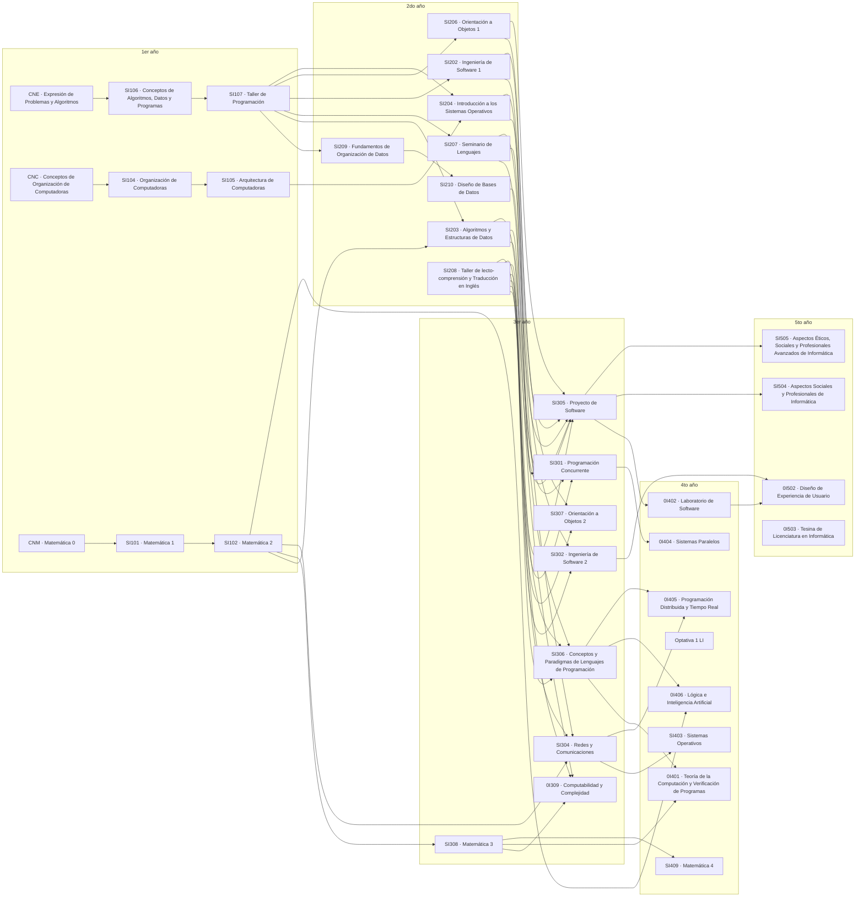

# Correlativas — Licenciatura en Informática (UNLP)

**Plan:** 2021  
**Fuente:** [Facultad de Informática UNLP — Licenciatura en Informática, Plan 2021](https://www.info.unlp.edu.ar/licenciatura-en-informatica-plan-2021/)

Convención del grafo: `A --> B` significa que **A es correlativa de B**, es decir, para cursar B necesitás A. Se usa la columna **Correlativas** del plan oficial. El plan no distingue acá entre cursar y rendir el final; no se duplican las aristas.

## Grafo

## Correlativas por materia

| Año | Código | Materia | Requiere |
|---|---|---|---|
| 1 | CNE | Expresión de Problemas y Algoritmos | — |
| 1 | CNC | Conceptos de Organización de Computadoras | — |
| 1 | CNM | Matemática 0 | — |
| 1 | SI106 | Conceptos de Algoritmos, Datos y Programas | CNE |
| 1 | SI104 | Organización de Computadoras | CNC |
| 1 | SI101 | Matemática 1 | CNM |
| 1 | SI107 | Taller de Programación | SI106 |
| 1 | SI105 | Arquitectura de Computadoras | SI104 |
| 1 | SI102 | Matemática 2 | SI101 |
| 2 | SI209 | Fundamentos de Organización de Datos | SI107 |
| 2 | SI203 | Algoritmos y Estructuras de Datos | SI102, SI107 |
| 2 | SI207 | Seminario de Lenguajes | SI107 |
| 2 | SI210 | Diseño de Bases de Datos | SI209 |
| 2 | SI202 | Ingeniería de Software 1 | SI107 |
| 2 | SI206 | Orientación a Objetos 1 | SI107 |
| 2 | SI204 | Introducción a los Sistemas Operativos | SI107, SI105 |
| 2 | SI208 | Taller de lecto-comprensión y Traducción en Inglés | — |
| 3 | SI308 | Matemática 3 | SI102 |
| 3 | SI302 | Ingeniería de Software 2 | SI202, SI208 |
| 3 | SI306 | Conceptos y Paradigmas de Lenguajes de Programación | SI203, SI207, SI208 |
| 3 | SI307 | Orientación a Objetos 2 | SI206, SI208 |
| 3 | SI304 | Redes y Comunicaciones | SI102, SI204, SI208 |
| 3 | SI301 | Programación Concurrente | SI204, SI207, SI208 |
| 3 | SI305 | Proyecto de Software | SI210, SI202, SI203, SI206, SI207, SI208 |
| 3 | 0I309 | Computabilidad y Complejidad | SI203, SI308, SI208 |
| 4 | 0I401 | Teoría de la Computación y Verificación de Programas | SI308, SI306 |
| 4 | SI403 | Sistemas Operativos | SI304 |
| 4 | 0I404 | Sistemas Paralelos | SI301 |
| 4 | — | Optativa 1 LI | Según la optativa elegida |
| 4 | 0I406 | Lógica e Inteligencia Artificial | SI102, SI306 |
| 4 | SI409 | Matemática 4 | SI308 |
| 4 | 0I402 | Laboratorio de Software | SI305 |
| 4 | 0I405 | Programación Distribuida y Tiempo Real | SI306, SI304 |
| 5 | 0I502 | Diseño de Experiencia de Usuario | SI302, 0I402 |
| 5 | SI504 | Aspectos Sociales y Profesionales de Informática | SI305 |
| 5 | SI505 | Aspectos Éticos, Sociales y Profesionales Avanzados de Informática | SI305 |
| 5 | 0I503 | Tesina de Licenciatura en Informática | Regla especial: todos los finales de 1º y 2º año + 2 finales más |

## Notas

- **0I503 Tesina:** no se puede expresar como aristas simples. Requiere tener aprobados todos los exámenes finales de 1º y 2º año y al menos 2 exámenes finales más.
- **Optativa 1 LI:** no tiene correlativas fijas; depende de la optativa que se elija. Por eso queda aislada en el grafo.
- El plan oficial escribe `OI402` (letra O) en la correlativa de `0I502`; acá se normaliza a `0I402` (cero).
- Si este grafo se usa como seed de la app, `0I503` y la optativa necesitan un tratamiento aparte: el modelo actual de correlativas solo admite pares materia → correlativa.
